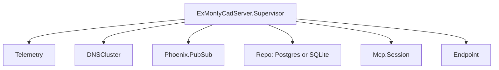

# How this server is put together

Three engines, one protocol. cadmpeg reads a CAD file, quiddity names what is in
it and answers the geometry, and the framework's own sensor module turns a sensed frame
into the percept a graph memory stores. This server is the surface over all three
plus the things only a server can do: keep a part open between requests, and
remember what it has learned.

## The protocol

One implementation, `ExMontyCadServer.Mcp`, is both transports. `handle/2` takes
one JSON-RPC message as a string and answers with the string to send back, and
nothing in it knows whether that string arrived on a pipe or over HTTP.

| method | what it answers |
| --- | --- |
| `initialize` | the revision both sides will speak, the capabilities, and the instruction text |
| `tools/list` | the catalogue, which is the tool reference this documentation includes |
| `tools/call` | one tool's answer: a sentence for the model and the numbers as structured content |
| `ping` | nothing, which is the whole point |

A request carries an `id` and is answered; a notification has none and is not.
The revision is negotiated over `2025-06-18`, `2025-03-26` and `2024-11-05`, and
a client that asks for something else is answered with the newest, because a
server that refuses a revision it half-speaks is worse than one that says which
one it will speak.

## The two transports

**stdio** — `mix ex_monty_cad_server.mcp` starts the application and answers on
stdin and stdout, one message per line. It refuses to start when either native
library is missing, because a server that starts and then fails every call is
harder to diagnose than one that does not start.

**HTTP** — `POST /mcp` in the `:api` pipeline. A message that is not JSON-RPC is
`400` with the protocol's parse error; a notification is `202` with no body.

A pipe keeps its state in its own loop. A request cannot: each one arrives in a
process that dies when it answers. So between requests the state — the documents
cadmpeg has open, the parts quiddity has read — lives in
`ExMontyCadServer.Mcp.Session`, one GenServer per server, and a call is answered
with the state it produced.

## The engines

Each engine already answers the protocol on its own, with its own `Tools` module,
its own `catalogue/0` and its own slice of state. This server does not
re-implement any of those answers: `ExMontyCadServer.Mcp.Tools.engines/0` says
which engine owns a name and the call is handed over with that engine's state.
Names carry their engine's prefix, so two engines cannot claim the same one.

`ExMontyCadServer.Mcp.MemoryTools` is what the server adds: the tools that need
all three engines at once, and the only ones that write.

| question | tool | what it takes |
| --- | --- | --- |
| what would a sensor perceive here | `monty_cad_sense` | a path, a point, a direction |
| what has been learned already | `monty_cad_libraries` | nothing |
| learn this part | `monty_cad_library` | a path, an object id, an output path |

The reference for every tool — every engine's, with argument schemas — is
[the tools page](tools.html), which is generated from the catalogue.

## The catalogue

`monty_cad_library` writes two things: the library file a run loads, and a row
that says what was written. The second is what makes the first findable next
week — the part by the digest of its bytes, the memory by the object it is
labelled as and how much of the part it saw.

The database is chosen when the server starts: Postgres when `DATABASE_URL`
names one, SQLite in a file otherwise, so a release on a machine with no database
server still keeps what it made. Both drivers are compiled in, which is why there
are two repo modules and one name (`ExMontyCadServer.Repo`) the application calls
them by.

## Supervision

The repo starts before the session, and the session before the endpoint: nothing
that answers a request may outlive the store it reads.
